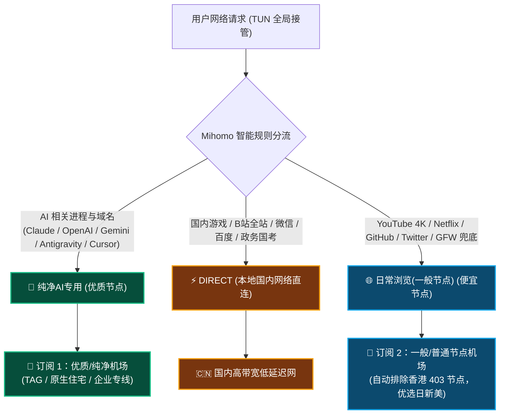

# 🚀 Clash Dual Fusion: 双订阅合体智能分流方案

<p align="center">
  
  
  
  
</p>

<p align="center">
  <strong>专为同时拥有「优质纯净节点」与「一般/普通节点机场」的进阶用户打造！</strong><br>
  只需要粘贴两个订阅链接，即可实现：<br>
  🤖 <strong>AI 严格走好节点</strong> (防封号/防403) ｜ 🌊 <strong>日常 4K 视频走一般/劣质节点</strong> (便宜耐造) ｜ 🎮 <strong>国内游戏与 B 站全直连</strong> (0ms 额外延迟)
</p>

---

## 💡 为什么需要这个项目？

很多技术开发者、科研工作者和重度 AI 用户通常面临以下三大痛点：

1. **优质节点流量极贵**：原生住宅/企业专线（如 TAG、家宽 IP）纯净度高，调用 Claude / OpenAI / Gemini 极稳不封号，但 **单价高、流量少**。如果日常看 4K YouTube、下载大模型权重或刷 Twitter，几天就会把贵重配额烧光。
2. **一般/劣质节点机场节点质量杂**：几块钱就能买到 300GB~1TB 的廉价机场，日常看视频极爽，但机房 IP 脏，频繁触发 Cloudflare 验证码；且 **香港（HK）、澳门（MO）节点被 Anthropic 官方严格封锁**，调用 Claude API 秒报 `403 Forbidden`。
3. **国内应用走代理导致风控与高延迟**：玩国服游戏（Steam、英雄联盟、原神、黑神话悟空等）或者刷 B 站视频时，如果混入代理，容易跳验证码、断连甚至触发异地登录风控。

**本方案解决了一切**：将两份订阅无缝融合，**进水不犯河水，自动各走各路**！

---

## 📊 三路智能分流架构图



---

## 🌟 核心特性

- 🎯 **两行链接，开箱即用**：用户只需粘贴「优质 AI 订阅」与「一般/劣质节点订阅」两个 URL，全自动合并。
- 🛡️ **Claude & OpenAI 零 403 封锁**：
  - 优质 AI 组严格过滤出 **美国 / 日本 / 新加坡** 黄金地区，彻底剔除香港/澳门等 403 封禁出口。
  - 自动测速组每 300 秒探测一次，哪个节点最低延迟走哪个。
- 📺 **一般节点防偷跑机制**：
  - YouTube、Netflix、Spotify、GitHub、Twitter、Telegram 等大流量海外应用强制锁定备用一般节点。
  - 任何未识别的未知境外流量默认走一般/劣质节点兜底（`MATCH`），绝不浪费好节点 1KB 流量！
- 🎮 **国内极速直连白名单**：
  - 覆盖 Steam 游戏下载/更新、WeGame、英雄联盟、绝地求生、无畏契约、原神、崩铁、黑神话悟空等全平台进程。
  - B 站全站音视频及多路 CDN 100% 直连，享受本地千兆极速画质。
  - 国考网（`scs.gov.cn`）、学信网、12306、各大银行政务系统直连。
- ⚡ **双持久化与假 IP (Fake-IP)**：集成性能优异的 gVisor TUN 虚拟网卡配置与防 DNS 污染解析。

---

## 🚀 极速使用教程 (任选一种)

### 方式一：网页端一键生成 (最推荐，零门槛)

本项目自带现代化 Web 生成器界面（纯前端本地运行，零上报，绝不泄露你的订阅 Token）：

1. 直接用浏览器打开本项目目录下的 `index.html`（或访问部署在 GitHub Pages 上的在线页面）。
2. 在输入框中分别粘贴你的两个订阅链接：
   * **订阅 1**：优质纯净 AI 订阅（如 TAG、原生住宅、专线）
   * **订阅 2**：一般/劣质节点订阅（几百 G 廉价流量）
3. 点击 **【一键生成合体配置文件】**。
4. 点击 **【下载 dual_fusion.yaml】**。

---

### 方式二：Python 命令行一键生成

适合开发者或自动化脚本场景：

```bash
# 克隆仓库
git clone https://github.com/your-username/clash-dual-subscription-ai.git
cd clash-dual-subscription-ai

# 交互式运行 (按提示粘贴链接)
python generator.py

# 或直接带参数运行
python generator.py \
  --premium "https://your-premium-airport.com/link/xxx" \
  --cheap "https://your-cheap-airport.com/link/yyy" \
  -o dual_fusion.yaml
```

---

### 方式三：直接编辑模板文件

打开 `config.template.yaml`，找到第 42 行与第 53 行，替换占位符即可：

```yaml
proxy-providers:
  premium_ai_provider:
    type: http
    url: "👉把这里替换为你的优质好节点订阅链接"
    ...

  general_provider:
    type: http
    url: "👉把这里替换为你的一般/劣质节点订阅链接"
    ...
```

---

## 📥 如何导入 Clash Verge Rev / Mihomo 客户端

生成好 `dual_fusion.yaml` 后，仅需 3 步即可生效：

1. 打开 **Clash Verge Rev** -> 点击左侧侧边栏 **【订阅】(Profiles)**。
2. 点击右上角 **【新建】** -> 类型选择 **`Local (本地配置)`**。
3. 将生成的 `dual_fusion.yaml` 直接拖入窗口（或浏览文件选中导入）。
4. **右键该配置卡片 -> 点击【使用】(Select)** 激活。
5. 开启 Clash Verge 的 **【TUN 模式】**（系统代理亦可），大功告成！

> 💡 **小贴士**：导入后，Clash Verge 内核会自动在后台定时同步刷新两个远程订阅，无需手动重复更新。

---

## 📋 分流策略与分级表

| 优先级 | 分组名称 | 出口策略 | 覆盖应用与域名范围 |
| :--- | :--- | :--- | :--- |
| **P1 (最高)** | `🤖 纯净AI专用(优质节点)` | 优质好节点 (美/日/新) | **Google AI Studio, Gemini, Antigravity 客户端, Claude API / 网页, OpenAI / ChatGPT, Cursor, Perplexity, Groq, Midjourney, DeepL** |
| **P2** | `DIRECT` | 本地直连 | **Steam, WeGame, 腾讯全系游戏, 米哈游全系游戏, 永劫无间, 黑神话悟空, 瓦罗兰特等** |
| **P3** | `DIRECT` | 本地直连 | **B 站全站音视频 (`bilibili.com`, `bilivideo.com`, `hdslb.com` 等所有 CDN)** |
| **P4** | `DIRECT` | 本地直连 | **国考政务 (`scs.gov.cn`, `gov.cn`), 12306, 学信网, 微信, 百度, 淘宝, 京东, CN 域名** |
| **P5** | `🌐 日常浏览(一般节点)` | 便宜节点 (日/新/美) | **YouTube 4K, Netflix, Disney+, Spotify, Twitch, GitHub, Docker, Vercel, Twitter, Telegram, Discord, Reddit, OpenRouter, Stripe** |
| **P6** | `🌐 日常浏览(一般节点)` | 便宜节点 | **内置 GFWList 规则库 (自动拦截数万个被墙海外站点)** |
| **P7 (兜底)**| `🌐 日常浏览(一般节点)` | 便宜节点 | **MATCH (所有未知境外流量全部走一般节点，防国内超时卡顿)** |

---

## ❓ 常见问题 FAQ

#### Q1: 为什么香港（HK）节点用不了 Claude？
**答**：Anthropic 官方对中国大陆、中国香港（HK）和中国澳门（MO）实施强风控封锁。出口 IP 若为香港，请求其 API 会直接报 `403 Forbidden`。本配置在 AI 策略组与一般节点组中自动加入了地区正则过滤，**优先选用日本（JP）、新加坡（SG）或美国（US）**，彻底避免踩坑。

#### Q2: 我换了新订阅链接怎么办？
**答**：重新运行 `python generator.py` 或网页生成器，重新生成并替换配置文件即可；若订阅链接本身未变，Mihomo 内核每 24 小时会自动静默更新节点列表。

#### Q3: 国内游戏真的不会走代理吗？
**答**：配置内置了精确的进程级规则（`PROCESS-NAME`）以及 `GEOSITE,category-games@cn,DIRECT` 规则，游戏本体流量 100% 直通本地网卡，无封号风险、无额外延迟。

---

## 📄 开源许可证

本项目基于 [MIT License](LICENSE) 开源。欢迎提交 PR、Issue 或 Star 支持！🌟
